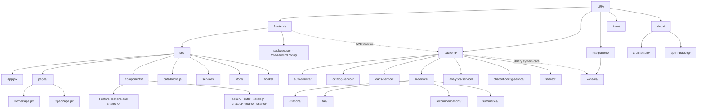

System architecture diagrams and supporting notes. Documents here should explain service boundaries, request and data flows, external dependencies, authentication paths, deployment relationships, and important tradeoffs.

Diagrams should be kept consistent with the repository structure and updated when a service contract or integration boundary changes. Architecture notes should include the date and status of significant decisions where useful.

## Repository Hierarchy

The frontend is the user-facing application, backend folders represent independently owned service boundaries, and the integration layer makes external systems explicit. README files under each area provide the local ownership and implementation notes.
